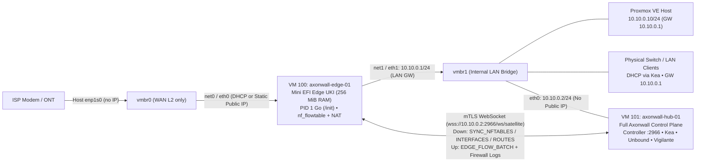

# Axonwall Mini EFI Edge NGFW on Proxmox VE (Controlled by an Internal Full Axonwall Hub VM)

This step-by-step guide deploys a **disaggregated two-VM security architecture** on a single Proxmox VE hypervisor:

1. **VM 100 (`axonwall-edge-01` — Super-Slim Mini EFI Edge NGFW UKI)**: A ~6.4 MB monolithic Linux 6.12 LTS UEFI Unified Kernel Image (`axonwall-edge-sku-vm-virtio.efi`) running a statically compiled Go PID 1 binary (`/init`) **100% in RAM**. It has **zero shell** (`/bin/sh`), **zero SSH daemon**, **`CONFIG_MODULES=n`** (structural LKM rootkit immunity), zero runtime disk writes, and owns the untrusted WAN perimeter (`vmbr0`) while providing LAN NAT + `nf_flowtable` fastpath forwarding to `vmbr1`.
2. **VM 101 (`axonwall-hub-01` — Internal Full Axonwall VM)**: A full Axonwall Debian 13 appliance running **strictly behind the firewall on `vmbr1`** (`10.10.0.2/24`, **no WAN NIC, no public IP address**). It serves the Next.js Web Console, Fleet Controller (`wss://10.10.0.2:2966/ws/satellite`), Kea DHCPv4, Unbound DNS, ZFS NAS, Vigilante SOAR, and Threat Harvester—pushing atomic `nftables`, interface, route, and WireGuard rulesets out to `edge-ngfw-01` over mutually authenticated TLS (mTLS) WebSockets (`EDGE_FLOW_BATCH` telemetry upstream).

---

## Architecture & Reference IP Plan



```text
+-----------------------------------------------------------------------------+
|                        ISP Modem / Upstream WAN                             |
+-----------------------------------------------------------------------------+
                                      |
                             Host NIC: enp1s0 (No IPv4, IPv6 disabled)
                                      |
                                  [ vmbr0 ]  (WAN Bridge - Host IP: None)
                                      |
                                  net0: eth0 (WAN IPv4/IPv6)
                         +-------------------------+
                         |  VM 100: axonwall-edge-01|  6.4 MB UKI in 256 MB RAM
                         |  (Mini EFI Edge NGFW)   |  CONFIG_MODULES=n, Zero Shell
                         +-------------------------+
                                  net1: eth1 (10.10.0.1/24)
                                      |
                                  [ vmbr1 ]  (VLAN-aware LAN Bridge -> enp2s0)
         +----------------------------+----------------------------+
         |                            |                            |
   10.10.0.10/24                10.10.0.2/24                 10.10.0.100-250/24
+-----------------+       +-----------------------+       +-------------------+
| Proxmox VE Host |       | VM 101: axonwall-hub-01|       | LAN Clients / APs |
| GW: 10.10.0.1   |       | Single NIC (eth0 only)|       | GW:  10.10.0.1    |
| No WAN IP       |       | GW: 10.10.0.1         |       | DNS: 10.10.0.2    |
+-----------------+       | NO PUBLIC IP ADDRESS  |       +-------------------+
                          +-----------------------+
```

| Node / Interface | Proxmox Bridge | Guest Device | Role | IPv4 Address | Default Gateway | Public Exposure |
| :--- | :--- | :--- | :--- | :--- | :--- | :--- |
| **Proxmox Host (`enp1s0`)** | `vmbr0` | — | WAN L2 transit only | **None** | — | None (L2 bridge only) |
| **Proxmox Host (`vmbr1`)** | `vmbr1` -> `enp2s0` | — | Hypervisor management | `10.10.0.10/24` | `10.10.0.1` | None (behind Edge) |
| **VM 100 (`edge-ngfw-01`)** | `vmbr0` (`net0`) | `eth0` | Untrusted WAN perimeter | ISP DHCP / Static | ISP Gateway | Exposed WAN NGFW |
| **VM 100 (`edge-ngfw-01`)** | `vmbr1` (`net1`) | `eth1` | LAN Default Gateway | `10.10.0.1/24` | — | Internal only |
| **VM 101 (`axonwall-hub-01`)** | `vmbr1` (`net0`) | `eth0` | Hub (`:2966`), DHCP, DNS, Console | `10.10.0.2/24` | `10.10.0.1` | **None (no WAN NIC)** |

> [!IMPORTANT]
> Boot **VM 101 (`axonwall-hub-01`) first** when initially provisioning PKI credentials, or set Proxmox startup ordering (`order=1` for `VM 100`, `order=2` for `VM 101`) afterward. Because VM 100 carries an autonomous Cloud-Init `/etc/nftables.conf` baseline ruleset, LAN clients and VM 101 keep full internet connectivity even if VM 101 reboots later.

---

## Step 1: Configure & Harden Proxmox VE Bridges

Configure Proxmox VE so **`vmbr0` has zero L3 addresses** (and rejects WAN IPv6 Router Advertisements so the hypervisor never exposes itself on ISP SLAAC), while **`vmbr1`** carries the internal management subnet (`10.10.0.0/24`) routed through `10.10.0.1`.

### 1.1 Edit `/etc/network/interfaces` on Proxmox

Replace `enp1s0` (physical WAN NIC) and `enp2s0` (physical LAN switch NIC) with the interface names on your Proxmox host (`ip -br link`):

```ini
auto lo
iface lo inet loopback

# Physical WAN NIC — L2 transit only, never configure an IP here
auto enp1s0
iface enp1s0 inet manual
    post-up sysctl -w net.ipv6.conf.enp1s0.disable_ipv6=1 net.ipv6.conf.enp1s0.accept_ra=0 || true

# WAN Bridge for VM 100 (net0) ONLY — Proxmox host has NO IP on WAN
auto vmbr0
iface vmbr0 inet manual
    bridge-ports enp1s0
    bridge-stp off
    bridge-fd 0
    post-up sysctl -w net.ipv6.conf.vmbr0.disable_ipv6=1 net.ipv6.conf.vmbr0.accept_ra=0 || true

# Physical LAN NIC connected to internal switch / APs
auto enp2s0
iface enp2s0 inet manual

# Internal LAN Bridge shared by Proxmox management, VM 100 (eth1), and VM 101 (eth0)
auto vmbr1
iface vmbr1 inet static
    address 10.10.0.10/24
    gateway 10.10.0.1
    dns-nameservers 10.10.0.2
    bridge-ports enp2s0
    bridge-stp off
    bridge-fd 0
    bridge-vlan-aware yes
    bridge-vids 2-4094
```

> [!TIP]
> **Safe Cutover Tip:** Plug your admin laptop directly into `enp2s0` (or the LAN switch) with a temporary static IP such as `10.10.0.50/24`, apply with `ifreload -a`, reconnect to Proxmox at `https://10.10.0.10:8006`, and plug your ISP modem/ONT into `enp1s0`.

### 1.2 Enable `snippets` Content on Proxmox `local` Storage

Proxmox needs the `snippets` content type enabled to pass custom `#cloud-config` files (`--cicustom`) to Cloud-Init:

```bash
pvesm set local --content iso,vztmpl,backup,snippets
mkdir -p /var/lib/vz/snippets /var/lib/vz/template/iso
```

Also ensure Proxmox's `dosfstools` / `fdisk` / `qemu-img` utilities are available for packaging the 64 MiB UEFI ESP image in Step 6:

```bash
apt-get update && apt-get install -y dosfstools util-linux qemu-utils
```

---

## Step 2: Stage or Build the Axonwall Artifacts

You need two artifacts on the Proxmox host:
1. **`axonwall-edge-sku-vm-virtio.efi`** — Single-file UEFI Unified Kernel Image (~6.4 MB) for **VM 100**.
2. **`axonwall-debian13-amd64-cloud.qcow2`** (or `axonwall-debian13-amd64.iso`) — Full Axonwall appliance image for **VM 101**.

### Option 2A: Download Official Release Artifacts on Proxmox

```bash
mkdir -p /var/lib/vz/template/iso /var/lib/vz/snippets
cd /tmp

# Replace <TAG> with your target release tag (e.g. v0.11.71 or rolling-latest)
REL_BASE="https://github.com/axonwall/axonwall/releases/download/<TAG>"
curl -fsSLO "${REL_BASE}/axonwall-edge-sku-vm-virtio.efi"
curl -fsSLO "${REL_BASE}/axonwall-edge-sku-vm-virtio.efi.sha256"
curl -fsSLO "${REL_BASE}/axonwall-debian13-amd64-cloud.qcow2"
curl -fsSLO "${REL_BASE}/axonwall-debian13-amd64-cloud.qcow2.sha256"

sha256sum -c axonwall-edge-sku-vm-virtio.efi.sha256
sha256sum -c axonwall-debian13-amd64-cloud.qcow2.sha256
```

### Option 2B: Build Locally From This Repository

```bash
# On your build host from the axonwall_monorepo root:
# 1. Build the ~6.4 MB Mini EFI Edge UKI (KVM/Proxmox VirtIO profile)
./packaging/edge-uki/build-edge-uki.sh --sku sku-vm-virtio --mode full-uki

# 2. Build the Full Axonwall Cloud QCOW2 image (requires live-build rootfs build)
sudo ./packaging/cloud-image/build-qcow2.sh

# Copy outputs to your Proxmox VE host /tmp/ directory:
scp \
  packaging/edge-uki/output/axonwall-edge-sku-vm-virtio.efi \
  packaging/cloud-image/output/axonwall-debian13-amd64-cloud.qcow2 \
  root@10.10.0.10:/tmp/
```

---

## Step 3: Deploy & Configure VM 101 (`axonwall-hub-01` — Internal Full Axonwall VM)

Deploy **VM 101 (`axonwall-hub-01`) first** so you can initialize its Hub PKI, ZTP token, DHCP/DNS services, and Fleet registry before booting the Mini Edge VM.

### 3.1 Create VM 101 Attached Exclusively to `vmbr1`

Run on the Proxmox host shell (`STORAGE=local-lvm`, or substitute `local-zfs` / your pool):

```bash
STORAGE="local-lvm"

qm create 101 \
  --name axonwall-hub-01 \
  --memory 8192 \
  --cores 4 \
  --cpu host \
  --machine q35 \
  --bios ovmf \
  --efidisk0 "${STORAGE}:1,efitype=4m,pre-enrolled-keys=0" \
  --scsihw virtio-scsi-single \
  --ostype l26 \
  --serial0 socket \
  --vga serial0 \
  --agent enabled=1 \
  --net0 "virtio,bridge=vmbr1,firewall=0" \
  --onboot 1 \
  --startup "order=2,up=10"

# Import Full Axonwall QCOW2 into VM 101 and expand root/data disk
qm importdisk 101 /tmp/axonwall-debian13-amd64-cloud.qcow2 "${STORAGE}" --format raw
qm set 101 --scsi0 "${STORAGE}:vm-101-disk-1,discard=on,iothread=1"
qm disk resize 101 scsi0 +32G
qm set 101 --boot "order=scsi0"

# Attach Cloud-Init drive so VM 101 boots with LAN IP 10.10.0.2/24 (no public IP)
qm set 101 --scsi1 "${STORAGE}:cloudinit"
qm set 101 --ciuser admin --cipassword "ChangeMeStrongPass!" \
  --ipconfig0 "ip=10.10.0.2/24,gw=10.10.0.1" \
  --nameserver "1.1.1.1"

qm start 101
```

*(Prefer installing manually from `axonwall-debian13-amd64.iso`? Replace `importdisk` with `--ide2 local:iso/axonwall-debian13-amd64.iso,media=cdrom`, create a `48G` `scsi0` disk, install onto it, and keep only one NIC on `vmbr1`.)*

Monitor firstboot until login prompt (`Ctrl+O` exits `qm terminal`):

```bash
qm terminal 101
```

### 3.2 Configure VM 101 as an Internal LAN-Only Hub (`/etc/axonwall/*.yaml`)

Log into `axonwall-hub-01` via `qm terminal 101` or `ssh admin@10.10.0.2` and configure the declarative YAML files so `axonwall-hub-01` **never configures a WAN interface**, maintains `10.10.0.2/24` with gateway `10.10.0.1` on `eth0` (`role: lan`), and runs Kea DHCPv4 + Unbound DNS for LAN clients.

1. **`/etc/axonwall/system.yaml`**:

```bash
sudo tee /etc/axonwall/system.yaml >/dev/null <<'EOF'
system:
  hostname: axonwall-hub-01
  domain: local
  timezone: UTC
  dnsServers:
    - 127.0.0.1
    - 1.1.1.1
  antiLockout:
    enabled: true
    interface: lan
    ports: [80, 443, 22, 3000, 2966]
EOF
```

> [!NOTE]
> `antiLockout` keeps TCP ports `80, 443, 22, 3000, 2966` reachable on the `lan` (`eth0`) interface (`10.10.0.2`) so `edge-ngfw-01` (`10.10.0.1`), the Proxmox host (`10.10.0.10`), and LAN admins can reach the Web Console (`:2966`) and WebSocket controller (`:2966`) while default-deny `nftables` still protects `axonwall-hub-01`.

2. **`/etc/axonwall/interfaces.yaml`**:

```bash
sudo tee /etc/axonwall/interfaces.yaml >/dev/null <<'EOF'
interfaces:
  - name: lan
    device: eth0
    role: lan
    type: static
    enabled: true
    ipv4Address: 10.10.0.2/24
    ipv4Gateway: 10.10.0.1
    mtu: 1500
    description: Internal Hub LAN Interface (no public WAN NIC)
EOF
```

> [!WARNING]
> Do **not** put a `0.0.0.0/0` default route inside `/etc/axonwall/routing.yaml` on `axonwall-hub-01`. The Hub forwards `routing.yaml` static routes down to `edge-ngfw-01` via `SYNC_ROUTES`, and pushing `0.0.0.0/0 via 10.10.0.1` to the Edge VM itself (`10.10.0.1`) would overwrite its ISP default route. Setting `ipv4Gateway: 10.10.0.1` in `interfaces.yaml` configures `axonwall-hub-01`'s own gateway in `/etc/network/interfaces` cleanly.

3. **`/etc/axonwall/services.yaml`** (Kea DHCPv4 + Unbound DNS advertising `10.10.0.1` as client default gateway and `10.10.0.2` as DNS):

```bash
sudo tee /etc/axonwall/services.yaml >/dev/null <<'EOF'
dhcp:
  enabled: true
  subnets:
    - interface: lan
      subnet: 10.10.0.0/24
      poolStart: 10.10.0.100
      poolEnd: 10.10.0.250
      routers:
        - 10.10.0.1
      dnsServers:
        - 10.10.0.2
      enabled: true

dns:
  enabled: true
  listenPort: 53
  dnssec: true
  dotEnabled: true
EOF
```

4. **`/etc/axonwall/ha.yaml`** (Fleet Controller registry for `edge-ngfw-01`):

```bash
sudo tee /etc/axonwall/ha.yaml >/dev/null <<'EOF'
fleet:
  enabled: true
  listenPort: 2966
  defaultHeartbeatIntervalSec: 30
  watchdogTimeoutSec: 60
  nodes:
    - id: edge-ngfw-01
      name: Perimeter Mini EFI Edge
      role: edge-ngfw
      edgePlacement: dedicated
      skuProfile: sku-vm-virtio
      arch: amd64
      os: AxonWall Edge UKI (PID 1 Go)
      fastpathOffload: true
      wanInterface: eth0
      lanInterface: eth1
      wanAddress: dhcp
      lanAddress: 10.10.0.1/24
      ipv6Mode: auto
      status: enrolling
      wireguard:
        tunnelIp: 10.99.0.2/24
        connected: false
EOF
```

*(If your ISP assigns a static IPv4 on WAN instead of DHCP, set `wanAddress: 203.0.113.2/24` above and include the gateway in the Cloud-Init file in Step 5.)*

5. **Validate and apply on `axonwall-hub-01`**:

```bash
sudo touch /etc/axonwall/.interfaces_configured
sudo axonwallctl validate
sudo axonwallctl apply --no-confirm

# Ensure eth0 and its default route through VM 100 (10.10.0.1) are active
sudo ip addr replace 10.10.0.2/24 dev eth0
sudo ip route replace default via 10.10.0.1 dev eth0
ip -br addr show dev eth0
ip route show
```

---

## Step 4: Issue mTLS Client Credentials & Extract Hub ZTP Token (`VM 101`)

`axonwall-controller` (`apps/axonwall-controller/src/index.ts`) enforces **two-layer authentication** on `wss://<hub>:2966/ws/satellite`:
1. The shared secret header `X-Axonwall-ZTP-Token` matching `AXONWALL_ZTP_TOKEN` in `/etc/axonwall/controller.env`.
2. A valid client TLS certificate signed by `/etc/axonwall/certs/ca.crt` whenever an Appliance/Operator CA is present (which `axonwall-rotate-hub-cert --ensure` creates automatically on first boot).

Run the following on **`axonwall-hub-01` (`VM 101`)**:

### 4.1 Ensure `hub.crt` Includes `10.10.0.2` in its SANs

If firstboot ran before `10.10.0.2` was assigned, rotate the CA-signed leaf certificate so the Edge VM's strict Go TLS verification passes against `wss://10.10.0.2:2966/ws/satellite`:

```bash
# Check existing SANs on hub.crt:
sudo openssl x509 -in /etc/axonwall/certs/hub.crt -noout -ext subjectAltName

# If IP Address:10.10.0.2 is missing, re-issue the leaf signed by ca.crt and restart controller:
sudo axonwall-rotate-hub-cert
sudo openssl x509 -in /etc/axonwall/certs/hub.crt -noout -ext subjectAltName
```

### 4.2 Mint an mTLS Client Certificate for `edge-ngfw-01`

```bash
sudo mkdir -p /root/edge-mtls
sudo chmod 0700 /root/edge-mtls

sudo openssl req -new -newkey rsa:2048 -nodes \
  -keyout /root/edge-mtls/satellite.key \
  -out /root/edge-mtls/satellite.csr \
  -subj "/O=Axonwall/OU=Satellite/CN=edge-ngfw-01"

cat <<'EOF' | sudo tee /root/edge-mtls/sat.ext >/dev/null
authorityKeyIdentifier=keyid,issuer
basicConstraints=CA:FALSE
keyUsage=digitalSignature,nonRepudiation,keyEncipherment,dataEncipherment
extendedKeyUsage=clientAuth
subjectAltName=DNS:edge-ngfw-01
EOF

sudo openssl x509 -req \
  -in /root/edge-mtls/satellite.csr \
  -CA /etc/axonwall/certs/ca.crt \
  -CAkey /etc/axonwall/certs/ca.key \
  -CAcreateserial \
  -out /root/edge-mtls/satellite.crt \
  -days 825 -sha256 \
  -extfile /root/edge-mtls/sat.ext

sudo rm -f /root/edge-mtls/satellite.csr /root/edge-mtls/sat.ext
sudo chmod 0600 /root/edge-mtls/satellite.key
sudo chmod 0644 /root/edge-mtls/satellite.crt

# Verify client cert chains cleanly to the Hub CA:
sudo openssl verify -CAfile /etc/axonwall/certs/ca.crt /root/edge-mtls/satellite.crt
```

### 4.3 Print the Values Needed for VM 100's Cloud-Init `user-data`

```bash
# 1. Shared ZTP enrollment token:
sudo grep '^AXONWALL_ZTP_TOKEN=' /etc/axonwall/controller.env

# 2. Copy ca.crt + satellite.crt + satellite.key safely over to Proxmox (/tmp/edge-mtls/):
```

From the **Proxmox VE host**, pull those files over LAN (or paste them directly):

```bash
mkdir -p /root/edge-mtls && chmod 0700 /root/edge-mtls
scp admin@10.10.0.2:/etc/axonwall/certs/ca.crt /root/edge-mtls/ca.crt
# If satellite.crt/.key are in /root/edge-mtls on VM 101, copy them as admin after chmod or ssh root:
ssh admin@10.10.0.2 "sudo cat /root/edge-mtls/satellite.crt" > /root/edge-mtls/satellite.crt
ssh admin@10.10.0.2 "sudo cat /root/edge-mtls/satellite.key" > /root/edge-mtls/satellite.key
ssh admin@10.10.0.2 "sudo grep '^AXONWALL_ZTP_TOKEN=' /etc/axonwall/controller.env | cut -d= -f2-" > /root/edge-mtls/ztp.token
chmod 0600 /root/edge-mtls/satellite.key /root/edge-mtls/ztp.token
```

---

## Step 5: Generate the Autonomous Cloud-Init `user-data` Snippet on Proxmox

Generate `/var/lib/vz/snippets/axonwall-edge-01-userdata.yaml` on the Proxmox host. Notice two key architectural features:
- All mTLS material (`ca_cert`, `client_cert`, `client_key`) and the ZTP token are embedded directly into Cloud-Init, which PID 1 writes to tmpfs RAM (`/etc/axonwall/certs/`).
- `write_files` provisions a **survivable baseline router ruleset** at `/etc/nftables.conf` so LAN hosts (`vmbr1`, including `axonwall-hub-01` and Proxmox) still route cleanly to the internet even during a Hub VM reboot. Once `edge-ngfw-01` connects to `wss://10.10.0.2:2966/ws/satellite`, the Hub replaces it with the full compiled `nf_flowtable` + blocklist + log ruleset via `SYNC_NFTABLES`.

Run this generator directly on your **Proxmox VE host**:

```bash
ZTP_TOKEN="$(cat /root/edge-mtls/ztp.token | tr -d '[:space:]')"

cat <<EOF > /var/lib/vz/snippets/axonwall-edge-01-userdata.yaml
#cloud-config
hostname: edge-ngfw-01
axonwall:
  hub: wss://10.10.0.2:2966/ws/satellite
  id: edge-ngfw-01
  token: ${ZTP_TOKEN}
  sku: sku-vm-virtio
  ca_cert: |
$(sed 's/^/    /' /root/edge-mtls/ca.crt)
  client_cert: |
$(sed 's/^/    /' /root/edge-mtls/satellite.crt)
  client_key: |
$(sed 's/^/    /' /root/edge-mtls/satellite.key)
  interfaces:
    - name: wan
      device: eth0
      address: dhcp
      ipv6_mode: auto
    # For static ISP WAN instead of DHCP, use:
    # - name: wan
    #   device: eth0
    #   address: 203.0.113.2/24
    #   gateway: 203.0.113.1
    #   ipv6_mode: disabled
    - name: lan
      device: eth1
      address: 10.10.0.1/24
      ipv6_mode: delegated

write_files:
  - path: /etc/nftables.conf
    permissions: "0600"
    content: |
      #!/usr/sbin/nft -f
      flush ruleset
      table inet axonwall {
        set blocked_ips {
          type ipv4_addr;
          flags interval;
        }
        set blocked_ips6 {
          type ipv6_addr;
          flags interval;
        }
        set blocked_macs {
          type ether_addr;
        }
        chain input {
          type filter hook input priority filter; policy drop;
          ct state established,related accept
          ct state invalid drop
          iif "lo" accept
          icmpv6 type { destination-unreachable, packet-too-big, time-exceeded, parameter-problem, echo-request, echo-reply, nd-router-solicit, nd-router-advert, nd-neighbor-solicit, nd-neighbor-advert } accept
          iifname "eth1" accept comment "allow-lan-control-plane"
          iifname "eth0" limit rate 10/second log prefix "axonwall-rule:wan-drop: " drop
        }
        chain forward {
          type filter hook forward priority filter; policy drop;
          ct state established,related accept
          ct state invalid drop
          iifname "eth1" oifname "eth0" accept comment "baseline-lan-to-wan"
        }
        chain output {
          type filter hook output priority filter; policy accept;
        }
        chain postrouting {
          type nat hook postrouting priority srcnat; policy accept;
          oifname "eth0" masquerade comment "baseline-wan-masquerade"
        }
      }
EOF

chmod 0600 /var/lib/vz/snippets/axonwall-edge-01-userdata.yaml
```

*(Delete `/root/edge-mtls/` on Proxmox once you are done creating and testing VM 100 if you do not wish to keep plaintext keys in `/root`.)*

---

## Step 6: Create VM 100 (`axonwall-edge-01` — Mini EFI Edge UKI) on Proxmox

You can boot the Mini EFI UKI on Proxmox using **Method A (Recommended UI/Snapshot-Friendly Read-Only UEFI ESP Disk)** or **Method B (Zero-Disk QEMU Direct `-kernel` + `-fw_cfg`)**.

> [!IMPORTANT]
> **Critical Cloud-Init Bus Rule (`--scsi1`, NEVER `--ide2`):**
> The minimalist `sku-vm-virtio` kernel compiles with `CONFIG_MODULES=n` and intentionally strips legacy ATA/IDE drivers (`# CONFIG_ATA is not set`) while baking in VirtIO-SCSI + SCSI CD-ROM (`CONFIG_SCSI_VIRTIO=y`, `CONFIG_BLK_DEV_SR=y`, `CONFIG_ISO9660_FS=y`). Always attach the Proxmox Cloud-Init drive to **`--scsi1`** on `--scsihw virtio-scsi-single`—never `ide2`.

### Method A: Standard Proxmox OVMF UEFI Boot with 64 MiB Read-Only ESP Disk (Recommended)

#### A1. Package `axonwall-edge-sku-vm-virtio.efi` into a 64 MiB GPT EFI System Partition

*(Why `64M`? FAT32 requires at least ~33 MiB of clusters to format cleanly.)*

```bash
rm -f /tmp/axonwall-edge-esp.raw
truncate -s 64M /tmp/axonwall-edge-esp.raw

# Create GPT partition 1 as EFI System Partition (C12A7328-F81F-11D2-BA4B-00A0C93EC93B)
printf "label: gpt\nsize=60M, type=C12A7328-F81F-11D2-BA4B-00A0C93EC93B\n" | sfdisk /tmp/axonwall-edge-esp.raw

LOOP_DEV="$(losetup -Pf --show /tmp/axonwall-edge-esp.raw)"
mkfs.vfat -F 32 -n AXON_EFI "${LOOP_DEV}p1"

mkdir -p /mnt/axon-esp
mount "${LOOP_DEV}p1" /mnt/axon-esp
mkdir -p /mnt/axon-esp/EFI/BOOT
cp /tmp/axonwall-edge-sku-vm-virtio.efi /mnt/axon-esp/EFI/BOOT/BOOTX64.EFI
ls -lh /mnt/axon-esp/EFI/BOOT/BOOTX64.EFI

umount /mnt/axon-esp
rmdir /mnt/axon-esp
losetup -d "${LOOP_DEV}"
```

#### A2. Create VM 100, Import the Read-Only ESP, and Attach NICs & VirtIO-SCSI Cloud-Init

```bash
STORAGE="local-lvm"

qm create 100 \
  --name axonwall-edge-01 \
  --machine q35 \
  --bios ovmf \
  --cpu host \
  --cores 2 \
  --memory 256 \
  --balloon 0 \
  --scsihw virtio-scsi-single \
  --ostype l26 \
  --serial0 socket \
  --vga serial0 \
  --watchdog "model=i6300esb,action=reset" \
  --onboot 1 \
  --startup "order=1,up=5"

# Secure Boot disabled (pre-enrolled-keys=0) for unsigned custom UKI (or enroll your own MOK/db key)
qm set 100 --efidisk0 "${STORAGE}:1,efitype=4m,pre-enrolled-keys=0"

# Import the 64 MiB ESP disk and attach read-only so Edge never writes to disk
qm importdisk 100 /tmp/axonwall-edge-esp.raw "${STORAGE}" --format raw
qm set 100 --virtio0 "${STORAGE}:vm-100-disk-1,ro=1"
qm set 100 --boot "order=virtio0"

# NIC ordering: net0 -> WAN (eth0), net1 -> LAN (eth1) with multiqueue
qm set 100 --net0 "virtio,bridge=vmbr0,firewall=0,queues=2"
qm set 100 --net1 "virtio,bridge=vmbr1,firewall=0,queues=2"

# Attach Cloud-Init via VirtIO-SCSI (NOT ide2) with our autonomous user-data snippet
qm set 100 --scsi1 "${STORAGE}:cloudinit"
qm set 100 --cicustom "user=local:snippets/axonwall-edge-01-userdata.yaml"
```

### Method B: Zero-Disk Alternative via QEMU `-kernel` + `-fw_cfg`

If you want VM 100 to have **zero virtual disks and zero Cloud-Init CD-ROMs**, stage the `.efi` binary directly in Proxmox snippets and pass it to QEMU via `--args`:

```bash
STORAGE="local-lvm"
cp /tmp/axonwall-edge-sku-vm-virtio.efi /var/lib/vz/snippets/axonwall-edge-sku-vm-virtio.efi

qm create 100 \
  --name axonwall-edge-01 \
  --machine q35 \
  --cpu host \
  --cores 2 \
  --memory 256 \
  --balloon 0 \
  --serial0 socket \
  --vga serial0 \
  --watchdog "model=i6300esb,action=reset" \
  --net0 "virtio,bridge=vmbr0,firewall=0,queues=2" \
  --net1 "virtio,bridge=vmbr1,firewall=0,queues=2" \
  --onboot 1 \
  --startup "order=1,up=5"

qm set 100 --args "-kernel /var/lib/vz/snippets/axonwall-edge-sku-vm-virtio.efi -fw_cfg name=opt/org.axonwall/user-data,file=/var/lib/vz/snippets/axonwall-edge-01-userdata.yaml"
```

*(Because QEMU `-args` requires root privileges on Proxmox API tokens, Method A is recommended for standard cluster/GUI management.)*

---

## Step 7: Boot VM 100 & Verify mTLS Control + Zero Public Hub Exposure

### 7.1 Boot VM 100 and Watch PID 1 Initialization

```bash
qm start 100
qm terminal 100
```

Within **< 2 seconds**, look for these JSON log markers on the serial console (press `Ctrl+O` to detach):

- `"Bootstrapping Axonwall Super-Slim Edge NGFW as PID 1 (/init)..."`
- `"Applied hardened kernel sysctls"`
- `"Applied autonomous Cloud-Init seed configuration"` *(shows `"source": "nocloud:block:/dev/sr0(iso9660)"` for Method A, or `"qemu-fw-cfg"` for Method B)*
- `"Loading Cloud-Init baseline router nftables ruleset from /etc/nftables.conf"`
- `"Pinning hub TLS verification to the appliance CA"`
- `"Running in secure mTLS mode"`
- `"Applied nftables ruleset via native NETLINK_NETFILTER"` *(right after `SYNC_NFTABLES` arrives from `axonwall-hub-01`)*

### 7.2 Verify from `axonwall-hub-01` (`VM 101`) & Proxmox

1. **Verify `VM 101` has ONLY an internal private IP and reaches the internet through `VM 100`**:

```bash
# On axonwall-hub-01 (VM 101):
ip -br link show                                  # Should show lo, eth0 (+ wg/tailscale if enabled); NO eth1/WAN NIC
ip -br addr show dev eth0                         # Should show ONLY 10.10.0.2/24
ip route show default                             # Should show: default via 10.10.0.1 dev eth0
ping -c 3 10.10.0.1                               # Reaches VM 100 LAN IP
ping -c 3 1.1.1.1                                 # Reaches WAN through VM 100
curl -s https://ifconfig.me && echo               # Returns ISP public WAN IP owned by VM 100
```

2. **Verify `VM 101` Controller sees `edge-ngfw-01` live telemetry & flowtable offload**:

Open the Hub Web Console from any LAN client or Proxmox jump host at `https://10.10.0.2:2966/fleet` (or query the controller API locally on `VM 101`):

```bash
# On axonwall-hub-01 (VM 101):
ZTP_TOKEN="$(sudo grep '^AXONWALL_ZTP_TOKEN=' /etc/axonwall/controller.env | cut -d= -f2-)"
curl -sk --cacert /etc/axonwall/certs/ca.crt \
  -H "X-Axonwall-ZTP-Token: ${ZTP_TOKEN}" \
  https://127.0.0.1:2966/api/v1/fleet/satellites | jq .
```

Confirm:
- `status`: `"online"`
- `role`: `"edge-ngfw"`
- `pid1Mode`: `true`
- `activeConns` & `offloadedConns` incrementing as LAN traffic traverses `VM 100`.

---

## Step 8: Day-2 Operations Controlled From `axonwall-hub-01` (`VM 101`)

### 8.1 Publish Internal Services via Edge DNAT (`portForwards`)

Never expose `axonwall-hub-01` `:2966` or Proxmox `:8006` directly on WAN. To publish an internal reverse proxy or service (e.g. `10.10.0.20:443`), edit `/etc/axonwall/ha.yaml` on `VM 101` under `edge-ngfw-01`:

```yaml
fleet:
  enabled: true
  listenPort: 2966
  nodes:
    - id: edge-ngfw-01
      name: Perimeter Mini EFI Edge
      role: edge-ngfw
      skuProfile: sku-vm-virtio
      wanInterface: eth0
      lanInterface: eth1
      wanAddress: dhcp
      lanAddress: 10.10.0.1/24
      fastpathOffload: true
      portForwards:
        - proto: tcp
          wanPort: 443
          targetIp: 10.10.0.20
          targetPort: 443
          comment: "Internal reverse proxy HTTPS"
```

Apply on `VM 101`:

```bash
sudo axonwallctl validate && sudo axonwallctl apply --no-confirm
```

### 8.2 Add Isolated 802.1Q VLAN Zones Over `vmbr1` (`zones:`)

Because Step 1 enabled `bridge-vlan-aware yes` on `vmbr1`, you can trunk IoT (`VID 40`) and Guest (`VID 50`) VLANs over `net1` (`eth1`) without adding extra virtual NICs to `VM 100`! Add `zones:` under `edge-ngfw-01` in `/etc/axonwall/ha.yaml` on `VM 101`:

```yaml
      zones:
        - name: iot
          vlanId: 40
          ipv4Cidr: 10.40.0.1/24
          ipv6Mode: disabled
          isolateClients: true
          allowInternet: true
        - name: guest
          vlanId: 50
          ipv4Cidr: 10.50.0.1/24
          ipv6Mode: delegated
          isolateClients: true
          allowInternet: true
```

When applied (`sudo axonwallctl apply --no-confirm`), the Hub pushes `SYNC_INTERFACES` (`eth1.40`, `eth1.50`) and updated isolation `SYNC_NFTABLES` rules directly to `edge-ngfw-01`.

### 8.3 Upgrade the Mini EFI Edge UKI in < 2 Seconds

Because `VM 100` stores zero state on disk, upgrades simply swap the immutable UKI binary and reboot:
- **Method A (ESP Disk)**: Mount `vm-100-disk-1` temporarily (or regenerate `/tmp/axonwall-edge-esp.raw` and `qm importdisk`) and replace `/EFI/BOOT/BOOTX64.EFI`, then run `qm reboot 100`.
- **Method B (`-kernel` snippet)**: Overwrite `/var/lib/vz/snippets/axonwall-edge-sku-vm-virtio.efi` and run `qm reboot 100`.

---

## Troubleshooting

| Symptom (`qm terminal 100` or Hub Logs) | Cause | Fix |
| :--- | :--- | :--- |
| `missing ZTP parameters` + PID 1 halts | Cloud-Init drive attached on `ide2` (`# CONFIG_ATA is not set` in `sku-vm-virtio.config`). | Remove `ide2`, reattach on **`--scsi1 local-lvm:cloudinit`** (`--scsihw virtio-scsi-single`). |
| UEFI shell / `Access Denied` on boot | OVMF Secure Boot enrolled default Microsoft keys (`pre-enrolled-keys=1`). | Recreate `efidisk0` with **`pre-enrolled-keys=0`** (or sign `.efi` with your enrolled custom key). |
| `401 Unauthorized` on `/ws/satellite` | `token:` in Cloud-Init `user-data` does not match `AXONWALL_ZTP_TOKEN` on `VM 101`. | Copy exact token from `/etc/axonwall/controller.env` on `VM 101` into `user-data` and reboot `VM 100`. |
| `403 Forbidden: unauthorized client TLS certificate` | `client_cert`/`client_key` missing in `user-data` or not signed by `ca.crt` on `VM 101`. | Mint `satellite.crt`/`satellite.key` from `/etc/axonwall/certs/ca.{crt,key}` (Step 4.2) and verify with `openssl verify`. |
| `x509: cannot validate certificate for 10.10.0.2` | `hub.crt` on `VM 101` was minted before `10.10.0.2` was assigned to `eth0`. | Run `sudo axonwall-rotate-hub-cert` on `VM 101` after `10.10.0.2` is up. |
| WAN/LAN swapped inside `VM 100` | `net0` and `net1` bridged backwards. | Ensure `net0` = `vmbr0` (WAN -> `eth0`) and `net1` = `vmbr1` (LAN -> `eth1`). |
